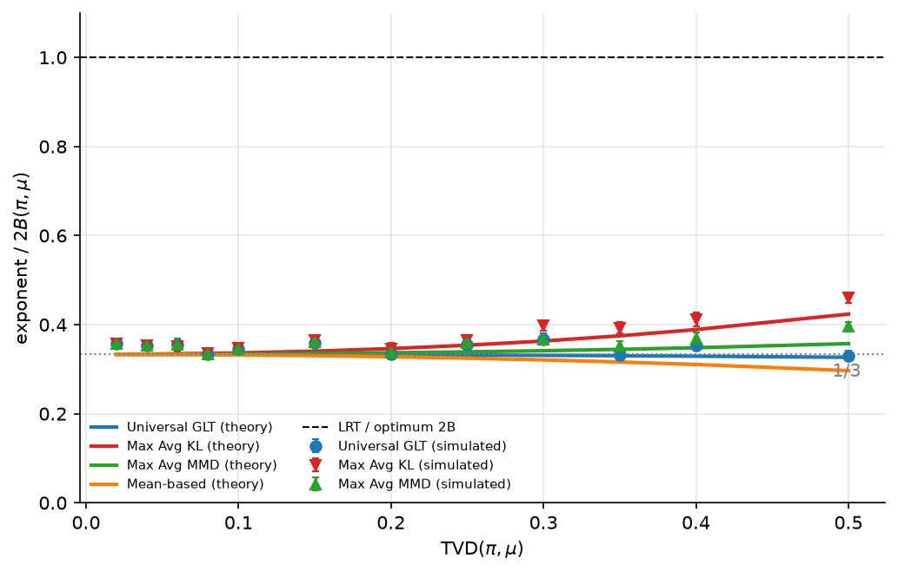
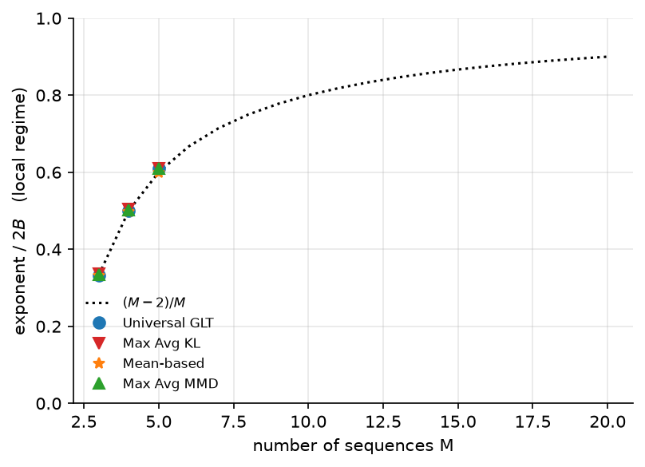
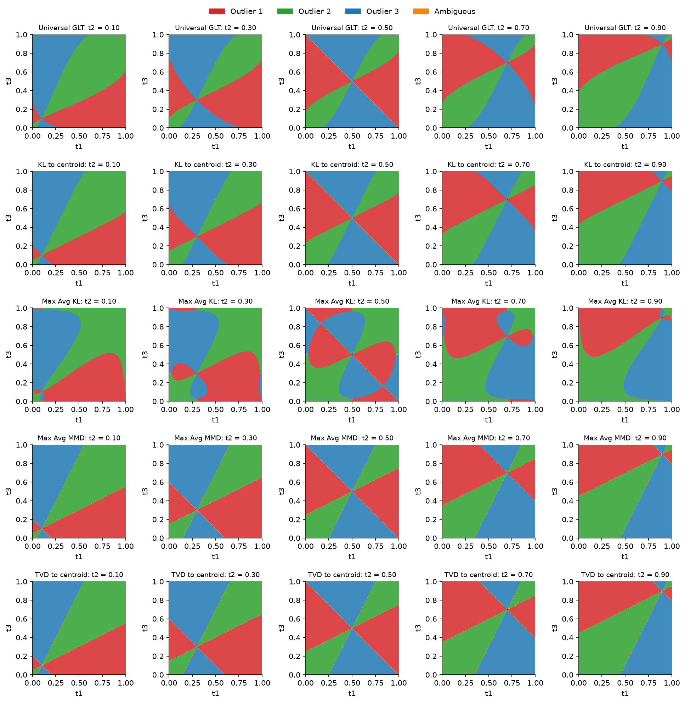
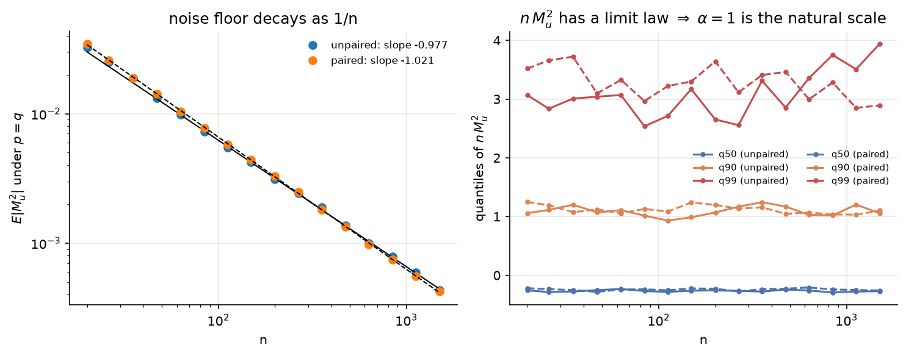
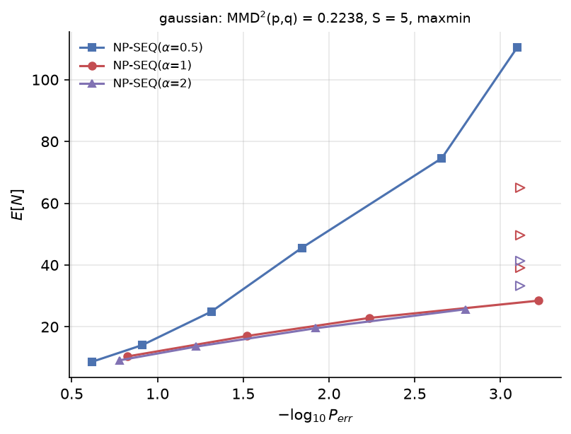

# Universal Outlier Hypothesis Testing — KL, MMD and GLT tests

Master's Thesis Project (MTP-1 and MTP-2) by Medavarapu Atchutha Rama Murthy under the
supervision of Prof. Jithin Ravi, Dept. E&ECE, IIT Kharagpur, building on a summer internship.

**Problem.** M data streams are observed; all but one follow an unknown
typical law π, one (the outlier) follows an unknown law μ. Neither law is
known. Find the outlier with as few samples as possible.

**What this repository does**

1. **Fixed-sample tests** (MTP-1). Compares universal rules — GLT (Li,
   Nitinawarat & Veeravalli), KL, MMD, TVD, closest-pair, mean/median-based —
   against the optimal exponent 2B(π, μ) of the test that knows π and μ.
2. **Theory meets simulation.** Computes each rule's exact large-deviation
   (Sanov) exponent from its decision region in type space — the "cube" plots —
   and shows that the simulations converge to it.
3. **Sequential test NP-SEQ** (internship, MTP-2). The MMD test of Sreenivasan
   & Bhashyam with threshold C / n^α, and why α = 1 is the right decay rate.

## Main results

| | |
|---|---|
|  | **For M = 3 every universal rule reaches ≈ 1/3 of the optimal exponent** in the hard regime, and exactly 1/3 in the limit (derivation in [docs/THEORY.md](docs/THEORY.md)). The efficiencies of 0.3–0.4 seen in MTP-1 are the correct answer, not a code problem. Simulation (markers) converges to theory (lines) from above. |
|  | The local-regime efficiency is **(M − 2)/M**: 1/3, 1/2, 3/5 for M = 3, 4, 5 → 1 as M grows, consistent with Li et al. |
|  | **Decision regions** in the (t1, t2, t3) cube, drawn exactly. MMD, TVD-to-centroid and closest-pair give the *same* partition for M = 3; Max-Avg-KL has edge lobes caused by D(P_j‖P_i) blowing up when P_i has an empty cell. In asymmetric problems this costs it badly (0.14 of 2B for π = Bern 0.7, μ = Bern 0.9) while the **GLT stays at 0.32–0.35: the GLT is the maximin-robust rule**. |
|  | **Why α = 1 (MTP-2).** Under the null, M_u² is a degenerate U-statistic: its noise floor decays as n^−1.00 (fitted slope −0.98 / −1.02, R² = 0.999) and n·M_u² has a limit law. A threshold C/n is matched to the noise; α < 1 is strictly worse, α > 1 is no better. |
|  | **NP-SEQ** reproduces the paper (S = 5, N(0,1) vs N(1.2,1)); E[N] follows (C / MMD²)^{1/α} (paper Thm 3 for α = 1). |

All numbers and figures are produced by the scripts in `experiments/`
(CSV next to every figure in `results/`).

## Quick start

```bash
python -m venv .venv && source .venv/bin/activate
pip install -r requirements.txt
pytest                                     # 48 tests, ~5 s

python experiments/error_exponents.py --preset quick        # ~1 min
python experiments/theory_exponents.py --sim quick          # ~5 min (exact P_e part)
python experiments/decision_regions.py                      # seconds
python experiments/np_seq.py --cases gaussian --trials 2000 # ~1 min
python experiments/alpha_study.py --trials 2000             # ~3 min
```

GPU (NVIDIA + CUDA): `pip install cupy-cuda12x`, then add `--backend gpu` to
`error_exponents.py` or `np_seq.py`. Everything runs on a laptop CPU as well;
the counts-based engine makes the GPU optional.

## Layout

```
src/universal_outlier/
  divergences.py     KL, Bhattacharyya, TVD, Chernoff
  problem.py         Problem(pi, mu, M), Bernoulli scenarios, count sampling
  decision.py        fair (random) tie-breaking, exact conditional error
  detectors/         one file per family, auto-registered
    kl.py  mmd.py  glt.py  baselines.py (LRT oracle, TVD)  mean_median.py
  mmd.py             MMD estimators: samples, counts, closed forms
  fixed_sample.py    Monte-Carlo and exact P_e(n)
  exponents.py       exponent fits (WLS with standard errors)
  theory.py          Sanov exponents from decision regions
  regions.py         decision regions in the type cube
  sequential.py      NP-SEQ with incremental MMD, NP-SEQ-UA (<= A anomalies)
  alpha.py           noise floor, stopping-time theory
  backend.py         NumPy / CuPy selection
experiments/         one script per study, writes to results/<study>/
tests/               pytest suite
docs/                THEORY.md, LEGACY_MAP.md, CHANGES_FROM_ORIGINAL.md
```

## Branches

Each feature was developed on its own branch and merged into `main` with a
merge commit, so `git log --graph` shows how the project was assembled and
any feature can be checked out on its own.

| branch | contents |
|---|---|
| `main` | everything, merged |
| `feature/core` | divergences, problem definition, tie-breaking, detector registry |
| `feature/kl` | KL rules only (core + KL) |
| `feature/mmd` | MMD estimators and MMD / closest-pair rules only |
| `feature/glt` | universal GLT only |
| `feature/baselines` | LRT oracle and TVD rules |
| `feature/mean-median` | Geiger et al. mean- and median-based tests |
| `feature/cpu-error-exponents` | Monte-Carlo / exact P_e(n), exponent fits, experiment 1 (CPU) |
| `feature/theory-exponents` | Sanov exponents, experiment 2 |
| `feature/decision-regions` | type-cube regions, experiment 3 |
| `feature/np-seq` | sequential NP-SEQ / NP-SEQ-UA, experiment 4 |
| `feature/alpha-study` | MTP-2 α study, experiment 5 |
| `feature/gpu` | CuPy backend for the same engines |
| `results/v1` | generated figures and tables |
| `archive/original-code` | the original scripts, untouched, one commit per project phase |

Which old script was the final one, and where it went:
[docs/LEGACY_MAP.md](docs/LEGACY_MAP.md). What was fixed:
[docs/CHANGES_FROM_ORIGINAL.md](docs/CHANGES_FROM_ORIGINAL.md).

## References

1. Y. Li, S. Nitinawarat, V. V. Veeravalli, *Universal outlier hypothesis testing*, IEEE Trans. Inf. Theory 60(7), 2014.
2. S. C. Sreenivasan, S. Bhashyam, *Sequential nonparametric detection of anomalous data streams*, IEEE Signal Process. Lett. 28, 2021.
3. B. C. Geiger, T. Koch, J. Mihaljević, M. Toller, *Universal outlier hypothesis testing via mean- and median-based tests*, arXiv:2601.00712, 2026.
4. A. Gretton, K. Borgwardt, M. Rasch, B. Schölkopf, A. Smola, *A kernel two-sample test*, JMLR 13, 2012.
